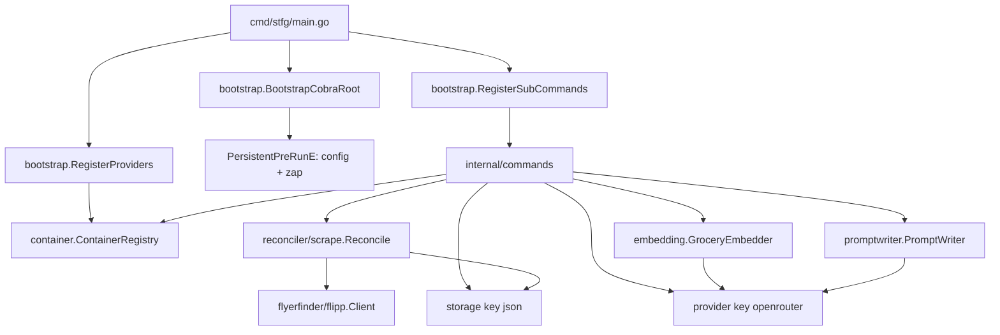
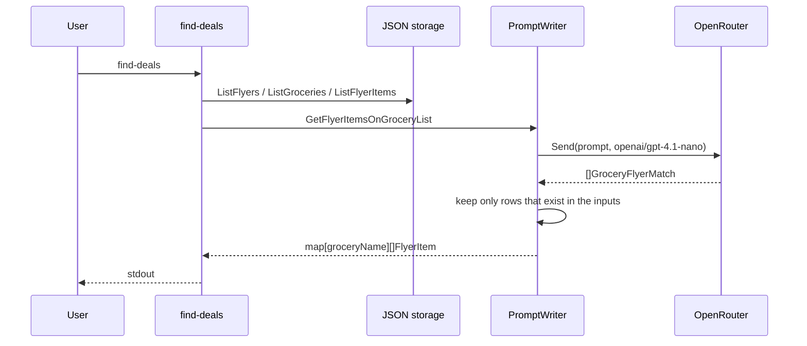

# Architecture

Snapshot of how `stfg` is organized today. Product direction is in [PROJECT_CONTEXT.md](PROJECT_CONTEXT.md). Tradeoffs are in [DECISIONS.md](DECISIONS.md).

## Overview

`stfg` is a single-process Cobra CLI. `cmd/stfg/main.go` is only the composition root. It builds the root command, registers storage and LLM loaders on a container, attaches subcommands, and calls `Execute`.

## Composition

`BootstrapCobraRoot` sets `SilenceErrors` and `SilenceUsage`. `PersistentPreRunE` calls `SetupConfiguration`, then `SetUpLogger`, then `zap.ReplaceGlobals`. It does not open storage or put the registry on the command context.

`RegisterProviders` stores loader functions. `GetStorage` and `GetProvider` invoke the loader for that call. Registered keys:

- storage: `json`, `sqlite`, `bolt`
- provider: `openrouter`, `ollama`, `openai`

Command constructors in `internal/commands` receive `*container.ContainerRegistry`. `RegisterSubCommands` attaches `scrape-flyers` and `find-deals` to the root, and `add-grocery`, `remove-grocery`, and `list-groceries` under `groceries`.

## Storage

`storage.StorageProvider` in `internal/storage/protocols.go` is the persistence contract: groceries, flyers, flyer items, `Migrate`, `Close`, and `PruneExpired`. DTOs are in `internal/storage/types.go`.

`storage.CacheDir()` is `os.UserCacheDir()/stfg`.

| Backend | Constructor | On disk |
|---------|-------------|---------|
| JSON | `json.NewJSON` | `groceries.json`, `flyers_index.json`, `flyer_<id>.json` in the cache dir |
| SQLite | `sqlite.NewSQLite` | `stfg.sqlite.db` unless `storage.sqlite.sqlite_file_name` is set |
| Bolt | `bolt.NewBolt` | `stfg.bolt.db` unless `storage.bolt.bolt_file_name` is set |

Commands pass `"json"`. The other backends are registered and tested, but no command selects them.

Grocery names are matched with `storage.NormalizeName` (`strings.ToLower`), not `strings.EqualFold`.

## Providers

`provider.Provider` has `Send` and `Embed`. `Send` returns `[]GroceryFlyerMatch` decoded from `{"matches":[...]}`. Schema and decode live in `internal/provider/utils.go`.

OpenRouter is constructed with the configured API key and a 3-minute client timeout. `Send` sets `RequireParameters`. OpenAI and Ollama implement the same interface and are registered, but no command looks them up.

## Flyer scrape

`scrape-flyers` does not call Flipp itself. It passes `flipp.NewFinder` and the JSON store to `scrape.Reconcile`.

`Reconcile` prunes expired flyers, loads flyers for the postal code, and keeps a flyer only when `Merchant + " " + Name` contains a `fly_finder.whitelist` entry. New flyers and their items are inserted. Existing flyer IDs are left alone.

`flipp.Client` uses gentleman. `FindFlyers` and `FindFlyerItems` satisfy `flyerfinder.FlyerFinder`.

## Embeddings and deal matching

`add-grocery` looks up OpenRouter, wraps it in `embedding.NewGroceryEmbedder` with model `nvidia/nemotron-3-embed-1b:free`, and stores the returned `[]float32` on `GroceryItem`. The embedder does not choose a provider or a model.

`find-deals` does not compare those vectors. It loads flyer items and grocery names and calls `PromptWriter.GetFlyerItemsOnGroceryList` with model `openai/gpt-4.1-nano`. The prompt payload is `id`, `brand`, `name`, and `displayType`. Returned matches must reference a real flyer row (`id` and `name`) and a grocery name from the input. Up to three attempts are made. Failures for one flyer are logged and the loop continues. Matches are printed to stdout.

## Logging and process exit

File logs are JSON, default path `stfg.log` in the working directory. Console logs go to the command stderr unless `--quiet` is set. Library and command code return errors. `main` writes one stderr line and exits 1. Command output uses `cmd.OutOrStdout()`.

## Tests

Tests are `*_test.go` next to the packages they cover, including storage parity across JSON, SQLite, and Bolt. Run `go test ./...`.
